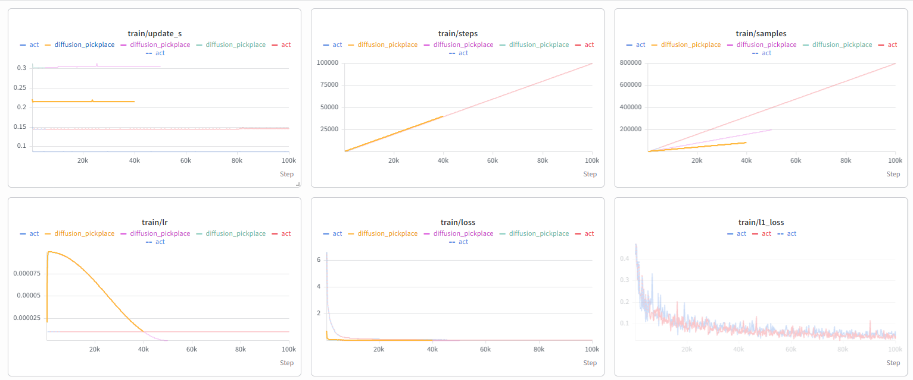

# SO-101 Imitation Learning: ACT Policy on Edge Hardware

End-to-end imitation learning on the open-source **SO-101** robotic arm: teleoperated data collection, training an **ACT (Action Chunking with Transformers)** policy with [LeRobot](https://github.com/huggingface/lerobot), and deploying it on an **Astra** edge board with a Torq NPU.

<p align="center">
  
</p>

<p align="center"><em>The trained ACT policy running on the Astra board and driving the SO-101: pick up the ball, place it in the box.<br>
<a href="media/inference_demo.mp4">Full 47 s video</a></em></p>

## Highlights

| | |
|---|---|
| Robot | SO-101 leader/follower arm pair |
| Policy | ACT (imitation learning, not a vision-language-action model) |
| Dataset | 106 teleoperated episodes, 35,671 frames at 30 fps |
| Training | 100k steps, batch 8, lr 1e-5, RTX 4060, 2 h 30 m |
| Compiled model | 69.2 MB, runs on the Astra board's Torq NPU |
| NPU inference | 298.4 ms median per policy call |
| Accuracy vs. fp32 | 0.36% relative L2, worst joint error 1.31° |
| Live result | **9 of 10 trials succeeded (90%)**, control loop at about 29.9 Hz |

## Pipeline

```
 leader arm ──teleop──▶ follower arm + cameras ──▶ LeRobot dataset (106 episodes)
                                                         │
                                                         ▼
                                              ACT training (RTX 4060)
                                                         │
                                                         ▼
                                        compile for the Torq NPU, check against fp32
                                                         │
                                                         ▼
                                  Astra board ──▶ SO-101 follower
```

1. **Data collection.** A human drives the leader arm while the follower arm and cameras are recorded with `lerobot-record`. Collection ran on a Windows laptop with no GPU.
2. **Training.** The dataset was moved to a Linux tower and an ACT policy trained with `lerobot-train`.
3. **Edge optimization.** The trained policy is compiled into a single model file for the Torq NPU and validated against the fp32 reference (details below).
4. **Deployment and evaluation.** The compiled model runs on the Astra board and drives the arm in a 30 Hz control loop, giving 9 of 10 successful trials.

## Task

The arm picks up an orange ball from the table and places it in a white box (see the demo above). In the full video it repeats the pick-and-place back to back.


## Training

<p align="center">
  
</p>

The L1 loss falls steadily over the 100k-step ACT run. The same W&B project also holds `diffusion_pickplace` runs, a diffusion-policy baseline on the same task.

## Edge optimization

The policy is trained in fp32 on the GPU, but the board's NPU runs it in **bf16** (bfloat16). Converting from fp32 to bf16 and proving the conversion did not change the arm's behavior was the main optimization step.

### Why bf16

- **Same dynamic range as fp32.** bf16 keeps fp32's 8-bit exponent and only drops mantissa bits (7 instead of 23). Weights and activations that span many orders of magnitude, as in a transformer, do not overflow or underflow, so the conversion needs no per-layer scaling.
- **No calibration data.** int8 quantization needs a representative dataset to pick scales, and a bad choice can quietly ruin a policy that outputs joint angles. bf16 is a plain cast.
- **Half the size and memory traffic.** Every weight takes 2 bytes instead of 4, which matters on an edge board where memory bandwidth, not arithmetic, usually limits latency.

### How the model was converted

1. Train the ACT policy in fp32 (100k steps, see above) and keep that checkpoint as the reference.
2. Compile the full policy, cast to bf16, into a single 69.2 MB model for the Torq NPU.
3. Run the compiled model on the board.

_Add the exact compile commands, tool versions, and which parts of the model (all weights, or only some layers) are bf16._

### How the error was verified

The question was whether bf16 changes what the arm is told to do. I fed the same 30 recorded frames (camera images and joint state) to both models and compared their outputs:

- **Reference:** the original fp32 PyTorch policy.
- **Test:** the compiled bf16 model running on the NPU.
- **Relative L2 error:** the norm of the difference between the two action outputs divided by the norm of the fp32 output. This came to **0.36%** (0.0036 as a fraction, not 36%): the bf16 outputs differ from fp32 by about a third of a percent of their size.
- **Error in joint degrees:** because the outputs are joint angles, the same comparison was also done in degrees. The mean absolute error is 0.130° (0.04° to 0.31° across joints), and the worst single case is 1.31° on the elbow.

An error of about a degree is small next to the arm's own tracking error, so bf16 was judged safe. The live test confirmed it: 9 of 10 pick-and-place trials succeeded.

### Latency

On the board the NPU takes a median of 298.4 ms per policy call (p95 298.6 ms) over 30 frames. Inside the live control loop the mean is 335 ms. A 120 s run held about 29.9 Hz with no hold-gaps across 3,584 control steps, with 2 USB camera dropouts.

## Results

| Metric | Value |
|---|---|
| Demonstrations | 106 episodes, 35,671 frames at 30 fps (19.8 min, 11.2 s per episode) |
| Training | 100,000 steps, batch 8, lr 1e-5, RTX 4060, 2 h 30 m 41 s |
| Compiled model | 69.2 MB |
| NPU inference | 298.4 ms median (p95 298.6) over 30 frames; 335 ms mean in the control loop |
| Accuracy against fp32 | 0.36% relative L2, mean abs error 0.130° (per joint 0.04 to 0.31), worst 1.31° (elbow), 30 frames |
| Live run on the board | 9 of 10 trials succeeded (90%); 120 s run at about 29.9 Hz, 0 hold-gaps in 3,584 steps; 2 USB camera dropouts |

## Hardware

- SO-101 leader + follower arms (Feetech servos)
- USB cameras
- Windows laptop (data collection, ADB link to the board)
- Linux tower, RTX 4060 (training)
- Astra board with Torq NPU (deployment)

## Reproducing

```bash
# 1. environment
python -m venv lerobot_env && source lerobot_env/bin/activate
pip install lerobot

# 2. calibrate and teleoperate
lerobot-teleoperate.exe --robot.type so101_follower --robot.port COM4 --robot.id follower --teleop.type so101_leader --teleop.port COM3 --teleop.id leader --robot.cameras "{ top: {type: opencv, index_or_path: 2, width: 320, height: 240, fps: 30, fourcc: MJPG}, wrist: {type: opencv, index_or_path: 1, width: 320, height: 240, fps: 30, fourcc: MJPG}}" --display_data True

# 3. record demonstrations
 lerobot-record.exe --robot.type so101_follower --robot.port COM4 --robot.id follower --teleop.type so101_leader --teleop.port COM3 --teleop.id leader --robot.cameras "{ top: {type: opencv, index_or_path: 2, width: 320, height: 240, fps: 30, fourcc: MJPG}, wrist: {type: opencv, index_or_path: 1, width: 320, height: 240, fps: 30, fourcc: MJPG}}" --display_data True  --dataset.repo_id vv1-dev1/Oct26 --dataset.num_episodes=80 --dataset.single_task="Mini basketball" --dataset.vcodec h264 --dataset.streaming_encoding=true --dataset.encoder_threads 6 --dataset.encoder_queue_maxsize=2000 --dataset.num_image_writer_processes=2 --dataset.push_to_hub True --dataset.episode_time_s 15 --resume True

# 4. train ACT
lerobot-train --dataset.repo_id /home/krg/Varsha/MiniBasketballRecordings --policy.type act --policy.repo_id train --wandb.enable true --wandb.project lerobot
```


## Acknowledgements

- [LeRobot](https://github.com/huggingface/lerobot) by Hugging Face
- [SO-101](https://github.com/TheRobotStudio/SO-ARM100) arm design by The Robot Studio
