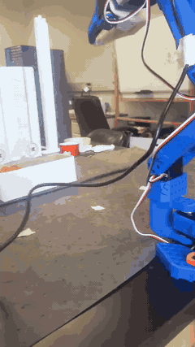

# SO-101 Imitation Learning: ACT Policy on Edge Hardware

End-to-end imitation learning on the open-source **SO-101** robotic arm: teleoperated data collection, training an **ACT (Action Chunking with Transformers)** policy with [LeRobot](https://github.com/huggingface/lerobot), and deploying it on a **Synaptics Astra** edge board with a Torq NPU.

<p align="center">
  
</p>

<p align="center"><em>The trained ACT policy running on the Synaptics Astra board and driving the SO-101: pick up the ball, place it in the box.<br>
<a href="media/inference_demo.mp4">Full 47 s video</a></em></p>

## Highlights

| | |
|---|---|
| Robot | SO-101 leader/follower arm pair |
| Policy | ACT (imitation learning, not a vision-language-action model) |
| Dataset | 200 teleoperated demonstrations |
| Result | **80% task success** on the real arm |
| Training | Linux workstation, NVIDIA RTX 4060 |
| Deployment | Synaptics Astra board, Torq NPU |

## Pipeline

```
 leader arm ──teleop──▶ follower arm + cameras ──▶ LeRobot dataset (200 episodes)
                                                         │
                                                         ▼
                                              ACT training (RTX 4060)
                                                         │
                                                         ▼
                                        export / quantize for the NPU
                                                         │
                                                         ▼
                                  Synaptics Astra board ──▶ SO-101 follower
```

1. **Data collection.** A human drives the leader arm while the follower arm and cameras are recorded with `lerobot-record`. Collection ran on a Windows laptop with no GPU.
2. **Training.** The dataset was moved to a Linux tower and an ACT policy trained with `lerobot-train`.
3. **Evaluation.** The policy was run on the real arm, giving 80% success on the task.
4. **Edge deployment.** The trained policy is deployed to a Synaptics Astra board, using its Torq NPU for inference

## Task

The arm picks up an orange ball from the table and places it in a white box (see the demo above). In the full video it repeats the pick-and-place back to back.


## Results

| Metric | Value |
|---|---|
| Demonstrations | 200 |
| Task success rate | 80% |
| Trials | 10 |
| Inference latency on board | 329ms |


## Hardware

- SO-101 leader + follower arms (Feetech servos)
- USB cameras
- Windows laptop (data collection, ADB link to the board)
- Linux tower, RTX 4060 (training)
- Synaptics Astra board with Torq NPU (deployment)

## Reproducing

```bash
# 1. environment
python -m venv lerobot_env && source lerobot_env/bin/activate
pip install lerobot

# 2. calibrate and teleoperate
lerobot-teleoperate.exe --robot.type so101_follower --robot.port COM4 --robot.id follower --teleop.type so101_leader --teleop.port COM3 --teleop.id leader --robot.cameras "{ top: {type: opencv, index_or_path: 2, width: 320, height: 240, fps: 30, fourcc: MJPG}, wrist: {type: opencv, index_or_path: 1, width: 320, height: 240, fps: 30, fourcc: MJPG}}" --display_data True

# 3. record demonstrations
 lerobot-record.exe --robot.type so101_follower --robot.port COM4 --robot.id follower --teleop.type so101_leader --teleop.port COM3 --teleop.id leader --robot.cameras "{ top: {type: opencv, index_or_path: 2, width: 320, height: 240, fps: 30, fourcc: MJPG}, wrist: {type: opencv, index_or_path: 1, width: 320, height: 240, fps: 30, fourcc: MJPG}}" --display_data True  --dataset.repo_id vv1-dev1/Oct26 --dataset.num_episodes=80 --dataset.single_task="Mini basketball" --dataset.vcodec h264 --dataset.streaming_encoding=true --dataset.encoder_threads 6 --dataset.encoder_queue_maxsize=2000 --dataset.num_image_writer_processes=2 --dataset.push_to_hub True --dataset.episode_time_s 15 --resume True

# 4. train ACT
lerobot-train --dataset.repo_id /home/krg/Varsha/MiniBasketballRecordings --policy.type act --policy.repo_id train --wandb.enable true --wandb.project lerobot
```


## Acknowledgements

- [LeRobot](https://github.com/huggingface/lerobot) by Hugging Face
- [SO-101](https://github.com/TheRobotStudio/SO-ARM100) arm design by The Robot Studio
